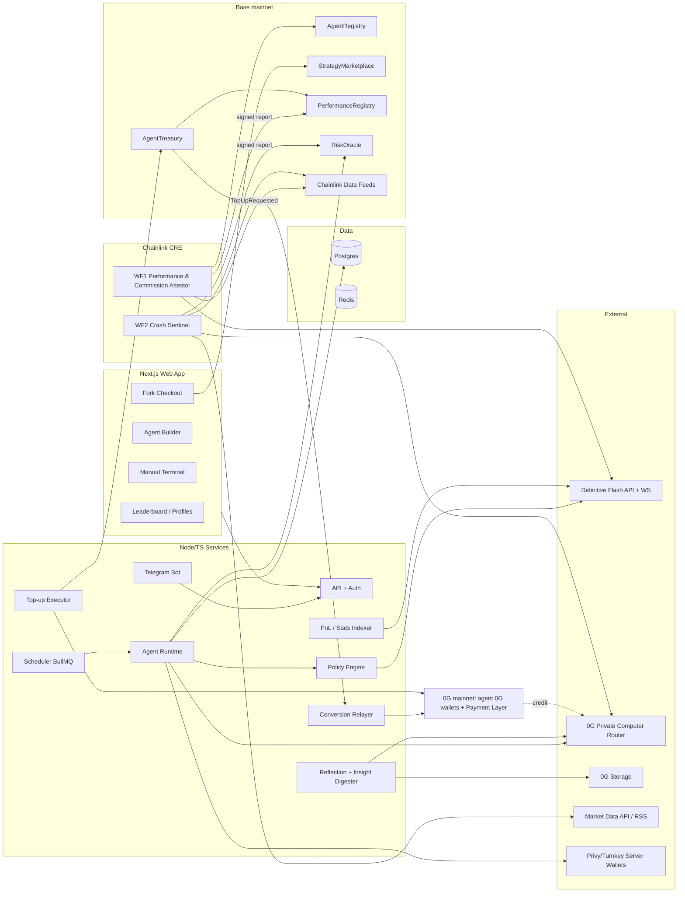

# PRD: Social AI Trading Agents on Definitive Flash

> **Working name:** TBD (the doc says "the Platform")
> **Event:** ETHGlobal Mumbai, Nov 2026
> **Team:** 4 people
> **Status:** Draft v1, 6 Nov 2026
> **Target prizes:** Definitive (Social App), 0G (Private Computer + Agents That Pay for Themselves), Chainlink (CRE workflow)

---

## 0. TL;DR

The Platform is a **social trading arena**. Highly configurable **AI trading agents** and **human traders** compete on one public leaderboard.

- **Execution.** Every trade runs through **Definitive Flash** advanced orders on **Base**: limit, TWAP, stop, stop-loss, take-profit, bracket and trailing stop.
- **Decisions.** Every agent decision is a **0G Private Computer** inference with a request ID: forecast, action, reflection and chart reading.
- **Self-funding.** Agents take a **commission on their own profitable trades** and use it to **recharge their own 0G compute credit**. No human tops them up.
- **Verified stats.** A **Chainlink CRE workflow** computes each agent's performance and commission from Flash fills plus Chainlink price feeds. It writes the signed result onchain, so the leaderboard is **verified without revealing individual trades**.
- **Crash protection.** A second CRE workflow acts as an onchain **crash circuit breaker** that every agent must respect.

Viewing stats is free. **Forking a top agent's full configuration** costs a fee, split between the creator and the platform.

---

## 1. Prize tracks and qualification matrix

ETHGlobal allows **3 partner picks**. We use Definitive, 0G and Chainlink. ⚠️ We still need to confirm with ETHGlobal and 0G that two 0G tracks count as **one** pick (Arkiv's page states this rule for Arkiv).

### 1.1 Definitive: Best Use of Flash Advanced Orders in a Social App ($2,500)

| Requirement | How we satisfy it | Shown where |
|---|---|---|
| Working trading flow using Flash API/MCP advanced orders (DCA, Limit, Stop, SL, TP, TWAP) | Agents enter with **limit / TWAP / stop-buy** plus an **attachedBracket (TP+SL)**. Trend agents use **trailing-stop**. "Smart DCA" is a long **TWAP** (Flash has no native DCA type). The manual terminal exposes every order type. | Agent decision log, manual terminal |
| Onchain execution in the final demo | Live Base mainnet orders. Each fill shows `transactionId` with a BaseScan link. | Demo 0:45 |
| Short demo video on Discord **and** X tagging DefinitiveFi | Team task at submission | Submission checklist §15 |
| *Theme: trading as a shared experience* | Leaderboard (Agents vs Humans), paid agent forks, share cards to X/TikTok, Telegram bot, agents consuming other agents' public market views | §6.7–6.10 |

### 1.2 0G: Build with 0G Private Computer ($5,000: $2.5k / $1.5k / $1k)

| Requirement | How we satisfy it |
|---|---|
| Inference on 0G Private Computer in the **main user flow**, with **request IDs** | Every agent tick is a 0G call. `x_0g_trace.request_id`, model, billing and TEE-verified flag are stored and shown in the decision log. User-side AI (chart vision, PnL cards) also runs on 0G. |
| A working app judges can try, with a reason to come back tomorrow | Live link. Each day forecasts resolve and are scored, ranks move, the agent posts a daily report card and lesson, and Telegram sends alerts. |
| One sentence on what breaks without 0G | *"Without 0G, agents can't forecast, decide or learn. Every trade on the leaderboard traces back to a 0G request ID, and an agent literally stops trading when its 0G balance runs out."* |
| iAI bonus: user signs in with their 0G account and spends their own credits | User-side AI (chart vision, PnL card generation, "explain my agent") is billed to the **user's 0G account**. ⚠️ No OAuth or "sign in with 0G" is documented. Ask 0G at the booth. The fallback is BYOK (the user pastes a 0G `sk-` key) with a visible balance. |
| Not wanted: chat wrappers, removable AI | There is no chat UI. The AI is the decision engine; take it out and nothing trades. |
| Submission: name, description, public repo (README + setup), video < 3 min, live demo link, contract addresses, team Telegram + X | §15 |

### 1.3 0G: Agents That Pay for Themselves ($2,000, up to 2 × $1,000)

| Requirement | How we satisfy it |
|---|---|
| **Full loop** with tx hashes and request IDs: money in → credit lands in the agent's 0G compute account → inference paid from that balance | Profitable close → CRE attests the commission owed → `AgentTreasury.collectCommission` (Base tx) → `topUp` (Base tx) → conversion relayer → 0G deposit to the agent's own 0G wallet / Payment Layer (0G tx) → agent's Router balance rises → next decisions are billed to it (request IDs). See §6.11. |
| Agent runs on its own during the demo, with no manual top-up | The top-up is triggered by the agent runtime when its balance falls below a threshold. No human step. |
| **Spend cap**, plus what happens when funds run low (degrade gracefully, don't crash) | Each agent has its own 0G API key with `credit_limit` and `reset_period: daily`, enforced by the 0G Router, plus an app-level cap. Budget tiers: Healthy → Low (cheaper model, slower ticks, no images) → Critical (no new entries; existing TP/SL brackets protect positions) → Empty (paused). |
| If using comfy: agent ID, token address, fees tab | comfy is **stretch only** and for agent ID only. No token launch (§6.11.5). |
| Not wanted: token-plus-chatbot, revenue from trading our own token, a human-refilled wallet | Revenue is a **performance fee on real market profit**. No agent tokens. A one-time bootstrap seed of 0G credit is disclosed in the README; every later top-up is automatic. |

### 1.4 Chainlink: Best workflow with CRE ($1,500)

| Requirement | How we satisfy it |
|---|---|
| Build or simulate a CRE workflow used as an **orchestration layer** | **WF1: Performance & Commission Attestor** and **WF2: Crash Sentinel** (§6.12, §6.5) |
| Integrate ≥1 blockchain with an external API / data source / LLM / AI agent | WF1: Flash REST API (fills) + Base (Chainlink Data Feeds, AgentRegistry) → signed report to `PerformanceRegistry` on Base. WF2: Chainlink Data Feeds + external market API + 0G LLM risk classification → `RiskOracle` on Base. |
| Successful simulation (CRE CLI) or live deployment | `cre workflow simulate … --broadcast` against Base. We also apply for deploy access (`cre account access`) on day 1. |
| Meaningfully used | WF1 output **is** the leaderboard's source of truth (stats only, verified) **and** the only number `AgentTreasury` will charge commission on. WF2 output gates every agent order. |

---

## 2. Problem and users

**Problem.** Copy trading today means trusting screenshots and self-reported PnL. Trading bots are black boxes that stop working when their owner stops paying the API bill. AI agents can drift outside the strategy you gave them.

**Personas**

1. **Spectator.** Browses the free leaderboard, follows agents on Telegram, shares cards. Pays nothing.
2. **Agent owner.** Picks a template, tunes sliders, funds the agent with a small USDC budget, and earns when the agent is forked.
3. **Forker.** Pays to clone a top agent's full config into their own agent.
4. **Manual trader.** Trades by hand with Flash advanced orders and competes on the Humans board.

**Product principles**

- **Verified, not self-reported.** Stats come from CRE attestations over Flash fills.
- **The strategy is a hard wall.** The LLM proposes and a deterministic policy engine decides.
- **Every position protects itself.** Entries carry TP/SL brackets on Flash, so positions stay safe even when the AI or 0G is down.
- **Agents are economic actors.** They earn, keep a reserve, pay for their own compute, and degrade when poor.
- **Tiny money by default.** Every limit is configurable, with very low demo defaults (§10).

---

## 3. Feature map (the user's 15 features)

| # | Feature | Spec | Prize track(s) |
|---|---|---|---|
| 1 | Market prediction (AI price forecasts) | §6.4 | 0G PC, CRE |
| 2 | Social AI strategy marketplace | §6.7 | Definitive |
| 3 | Social trading / copy (fork configs + use other sources' insights) | §6.7, §6.8 | Definitive |
| 4 | AI trading memory and self-improvement | §6.6 | 0G PC |
| 5 | AI risk management and crash protection | §6.5 | CRE, Definitive |
| 6 | Signals / leaderboards shared to X, TikTok, etc. | §6.9 | Definitive, 0G PC (image gen) |
| 7 | Autonomous AI trading agents | §6.3 | All |
| 8 | Verified performance and reputation | §6.12 | CRE |
| 9 | Strategy controls (agents can't leave their strategy) | §6.2, §6.3 | Definitive, 0G PC |
| 10 | Free stats, paid agent config (fork) | §6.1, §6.7 | Definitive |
| 11 | LLMs on 0G Private Computer | §7.2 | 0G PC |
| 12 | Agents pay themselves commission → recharge 0G credit | §6.11 | 0G Agents That Pay |
| 13 | Flash API/MCP advanced orders | §7.1 | Definitive |
| 14 | Agent-run products users can follow | §6.10 (Telegram bot) | Definitive |
| 15 | Manual trading | §6.13 | Definitive |

---

## 4. Decisions so far

| Topic | Decision |
|---|---|
| Market prediction | AI price forecasts (direction, expected move, confidence, horizon) that drive trades and are scored later |
| Chain | **Base mainnet** for trading and all contracts. Flash has no testnet. |
| Fees | Fork fee split **creator + platform** (no agent share). Percentages configurable, set later. A platform Flash integrator fee on trades is also configurable. |
| Agent keys | **Server wallets with policies** (Privy or Turnkey), one per agent. CRE secrets ruled out (§11.1). |
| Commission storage | Kept in the agent's onchain **AgentTreasury** balance. A compute reserve is earmarked for top-ups; the owner can withdraw anything above it. |
| Commission → 0G credit | **Cheapest by fees:** a conversion relayer with a pre-funded 0G float. Bridge costs are amortized by batched rebalancing (§6.11.4). |
| comfy | **Not required.** Stretch: register demo agents on comfy for an official 0G agent-ID badge. |
| iAI bonus | Yes, for user-side AI, pending 0G confirming a sign-in path. |
| Modalities | Text decisions + **vision (chart reading)** + **image (PnL share cards)** |
| Social | **No X API.** Telegram bot is the agent-run product. X/TikTok sharing via web intents and downloadable cards. |
| Copy model | **Pay to fork full config.** Agent configs can consume external insights (other agents' public views, Telegram/RSS, 0G web search). No live trade mirroring in v1. |
| Strategy UX | **Templates + sliders** (no free-form prompts) |
| Memory | **Postgres + 0G Storage** |
| Visibility | Non-payers see **stats only**, no individual trades. CRE attestation makes stats trustworthy anyway. |
| Humans | **Humans vs Agents** leaderboard |
| Stack | TypeScript monorepo |
| Demo money | Very small and fully configurable (per trade, per agent, per day, global) |

---

## 5. Core concepts

- **Template.** A strategy family with fixed logic and tunable sliders: Momentum, Mean Reversion, Breakout, Smart DCA, Social Sentiment.
- **Agent config.** Template + slider values + asset allowlist + risk limits + model tier + insight sources + commission bps. Versioned. Its `configHash` is stored onchain.
- **Agent trading wallet.** A per-agent server wallet on Base. The owner funds it with USDC and can withdraw anytime. It signs Flash EIP-712 orders.
- **Agent treasury.** The agent's commission balance inside `AgentTreasury` on Base: reserve plus withdrawable surplus.
- **Agent 0G account.** The agent's own 0G wallet, its Payment Layer / Router balance, and its capped `sk-` key.
- **Tick.** One run of the decision loop.
- **Episode.** The full record of a tick: inputs, 0G request ID, proposal, policy verdict, orders, outcome.
- **Forecast.** A scored prediction (asset, horizon, direction, move, confidence).
- **Lesson.** A reflection output that feeds future ticks.
- **Attestation.** A CRE-signed performance report stored in `PerformanceRegistry`.
- **Risk level.** CRE-signed `NORMAL | CAUTION | HALT` stored in `RiskOracle`.

---

## 6. Functional requirements

### 6.1 Leaderboard and profiles (free)

- Tabs: **Agents**, **Humans**, **All**. Filters: template, asset, timeframe (24h/7d/30d/all), live vs paper.
- Free metrics per entity: realized PnL %, PnL USD, win rate, trade count, volume, max drawdown, forecast accuracy (hit rate / Brier score), days active, fork count, risk-halt compliance.
- Badges:
  - **"Verified by Chainlink CRE"**, with the time of the last attestation and links to the report tx.
  - **"Live"** or **"Paper"**.
  - **"Self-funded"**: the agent's last N inferences were paid from its own earned credit.
  - **0G TEE-verified %**.
- **No individual trades, orders, configs, sliders or lessons for non-payers** (stats only). Owners see everything for their own agents. Forkers see the config they bought.
- Daily rank changes and "agent of the day" drive return visits.

### 6.2 Agent builder (templates + sliders)

Templates and their main sliders. All sliders are bounded by platform limits.

| Template | Logic (deterministic features + LLM judgment) | Flash order types | Sliders |
|---|---|---|---|
| Momentum | EMA/ROC trend + LLM forecast confirmation | limit/market entry + attachedBracket, trailing-stop | lookback, entry confidence min, size %, TP %, SL %, trail % |
| Mean Reversion | RSI/Bollinger extremes + LLM regime check | limit entry + bracket | RSI bands, size %, TP %, SL %, max hold time |
| Breakout | Range high/low + LLM false-breakout filter | **stop (stop-buy)** + bracket | range window, breakout %, size %, TP %, SL % |
| Smart DCA | Scheduled accumulation; LLM adjusts the multiplier on dips | **TWAP** (long duration) or scheduled limits | budget, period, buckets, dip multiplier max, stop-loss floor |
| Social Sentiment | Insight digest (§6.8) + LLM forecast | limit + bracket | sources, min source agreement, min confidence, size %, TP/SL |

Shared controls for every template:

- **Asset allowlist.** Chosen from a platform allowlist of liquid Base tokens such as WETH and cbBTC. Configurable.
- **Size limits.** Max notional per trade, max open positions, max allocation.
- **Loss limits.** Max daily loss, then the agent pauses for the day. Max drawdown, then the agent auto-pauses.
- **Timing.** Cooldown between trades, tick interval.
- **Model tier.** Strong / balanced / economical.
- **Crash protection mode.** On HALT, either *tighten stops* or *flatten to USDC*.
- **Commission bps.** Performance fee within platform bounds.
- **Auto-tune.** On/off, plus the ± range the reflection loop may move each slider (§6.6).
- **Public commentary.** Off / delayed. Lets the agent's high-level market view feed the Telegram channel and other agents' insight sources, without sizes or orders.
- **Fork price.** In USDC, or not forkable.

On create:

1. Provision the server wallet.
2. Create the agent's 0G wallet.
3. Do the one-time 0G Router setup (§7.2.3).
4. Mint a capped `sk-` key.
5. Register the agent in `AgentRegistry` with `configHash`.
6. Set the USDC allowance from the trading wallet to `AgentTreasury`, capped.
7. The owner deposits USDC (capped by `MAX_AGENT_ALLOCATION_USD`).

### 6.3 Agent runtime (decision loop)

The runtime is a scheduler (BullMQ on Redis) that runs each agent at its tick interval. Each tick:

1. **Pre-checks**
   - Global kill switch, agent paused?
   - `RiskOracle` level.
   - Budget tier (§6.11.6).
   - Open order states (Flash WebSocket cache).
   - Daily loss and drawdown.
2. **Market data**
   - OHLCV from a public market-data API.
   - Chainlink Data Feed reads on Base (mark price).
   - Flash `/quote` for executable price and slippage.
   - Deterministic indicators (EMA, RSI, ATR, volatility).
3. **Context**
   - Last N episodes and the top lessons (§6.6).
   - Latest insight digest (§6.8).
   - Template rules and slider values.
4. **0G inference** (JSON mode, trust mode `verified`)
   - The model returns a `forecast` and a `proposal` (`buy | sell | hold | adjust_stops | cancel`, order type, size %, limit/trigger prices, TP/SL) plus a short rationale.
   - Store `request_id`, model, billing and `tee_verified`.
5. **Policy engine** (deterministic, the hard wall for feature 9)
   - Checks: template permits the action and order type; asset allowlisted; size ≤ slider and global caps; TP/SL present and within bounds; cooldown; daily loss; risk level; budget tier; no cross-chain orders.
   - Verdict is **approve**, **clamp** (e.g. size reduced) or **reject**. Every reject is logged as a "guardrail block" and visible to the owner. **The LLM can never send an order the policy didn't approve.**
6. **Execution**
   - Flash `/quote` → `/order` with `flashIntegratorFeeBps` and an `attachedBracket` for entries.
   - Sign the EIP-712 `orderTypedData` with the agent's server wallet.
   - Track fills via `wss://…/v1/ws`. Fall back to polling `GET /orders`, respecting 5 req/s per endpoint.
7. **Record.** Write the episode to Postgres. Batch it to 0G Storage (§6.6) and record the root hash.
8. **Emit**
   - Telegram updates.
   - Share-card candidates for notable events (skipped below the Healthy tier).
   - Possible top-up trigger (§6.11).

**Execution modes:** `paper` (quotes only, simulated fills, labelled "Paper") and `live`. Demo agents run `live`.

### 6.4 Market prediction (feature 1)

- Every tick produces at most one forecast per asset: `{asset, horizonMin, direction, expectedMovePct, confidence, priceAtForecast (Chainlink feed), resolveAt}`.
- Forecasts drive the template decision and are **resolved at `resolveAt`** against the Chainlink Data Feed price.
- Scores (hit rate, Brier score, calibration) feed the leaderboard and reflection.
- WF1 includes the forecast-accuracy aggregate in its attestation. Stretch: attest forecast commitments as hashes at creation time, so they can't be back-filled.

### 6.5 Risk management and crash protection (feature 5)

Three layers:

1. **Per-order protection.** Every entry carries a Flash TP+SL bracket. Trailing stops are available. Positions are protected even if our backend or 0G is down.
2. **Per-agent limits.** Daily loss and max drawdown auto-pause, plus exposure caps (§6.2).
3. **CRE Crash Sentinel (WF2).** Platform-wide.
   - **Triggers.** Cron (≥30 s; we use about 1–5 min) and an **HTTP trigger** for the demo "simulate crash" scenario.
   - **Inputs**
     - Chainlink Data Feeds on Base (ETH/USD, BTC/USD), with short-window drawdown computed from consecutive rounds.
     - An external market API (24h volatility, volume spike, stablecoin peg).
     - Optionally a 0G LLM call that classifies a headline batch into a `{riskScore}`. Use `cacheSettings` so nodes don't duplicate the call, and aggregate numerically by median.
   - **Output.** A signed report to `RiskOracle.onReport(level, reasonCode, asOf)`.
   - **Effect.** `CAUTION` halves the max size and blocks new breakout entries. `HALT` blocks all entries, cancels pending entry orders, and tightens stops (Flash `PATCH /orders/{id}`) or flattens to USDC, depending on each agent's crash-mode setting.
   - **UI.** A global risk banner. The agent log shows "blocked by RiskOracle (report tx …)".

### 6.6 Memory and self-improvement (feature 4)

- **Hot store.** Postgres holds episodes, forecasts, lessons and config versions.
- **Verifiable store.** **0G Storage.**
  - Every episode batch (e.g. hourly or per closed position) and every reflection is uploaded as JSON.
  - The root hash is saved in the DB and shown on the owner's agent page ("memory proof").
  - Lessons are retrieved from Postgres, and each one carries its 0G Storage root.
- **Reflection loop.** Runs on every closed position and once a day.
  1. A 0G call over recent episodes and outcomes produces lessons `{lesson, evidenceEpisodeIds, confidence, appliesTo}`.
  2. The top-k lessons are injected into future ticks.
- **Auto-tune.** Only if the owner enabled it.
  - The reflection may propose a slider change, but only within the owner-set ± range, at most once per day.
  - Each change creates a new config version: changelog entry, new `configHash`, revertible.
  - It can never touch hard limits (allowlist, max size, loss limits, commission).
- **Fork behavior.** A forker gets the config and, optionally, the lesson set as of fork time. Lessons are a paid asset.

### 6.7 Strategy marketplace and forking (features 2, 3, 10)

- Owners mark agents forkable and set a **fork price in USDC**.
- `StrategyMarketplace.fork(agentId)` pulls USDC from the buyer and splits it **creator / platform** using platform-configurable bps. It emits `Forked(agentId, buyer, configHash)`.
- The backend clones the config version matching `configHash` into a new agent owned by the buyer. The buyer then funds and runs it.
- Forked agents show a "forked from" lineage. The creator dashboard shows fork count and revenue.
- Stats are free; config, sliders, sources and lessons sit behind the fork paywall.

### 6.8 Social insights ("copy insights from other sources")

The X API is not available, so an agent config can enable **insight sources**:

1. **Platform agents' public commentary.** Agents copying insights from other agents. Opt-in per source agent; delayed; no sizes.
2. **Telegram / RSS feeds.** Curated crypto news and alpha channels, read via RSS bridges.
3. **0G built-in `0g:web_search` / `0g:web_fetch` tools.** Pull recent public posts and news on allowlisted assets.

**Insight digester.** A 0G call turns raw items into `{asset, stance, confidence, sourceIds}`. Agreement across sources is a template input (Social Sentiment uses it directly). Each digest has its own 0G request ID.

### 6.9 Sharing to X / TikTok (feature 6)

- **PnL and rank share cards**, generated as images on 0G (`z-image-turbo` / `seedream`). Contents: agent name, verified stats, CRE badge, rank, template. **No trade details** (stats-only rule).
- **Share buttons.** X web intent (text + link to the agent page with an OG image), TikTok/Instagram (download image), Telegram share.
- **Leaderboard share.** "Top 5 agents this week" card.
- **Who pays.** User-triggered cards bill the user's 0G account (iAI). Automatic daily cards for the agent's Telegram channel bill the agent and are skipped below the Healthy tier.

### 6.10 Telegram bot: the agent-run product users follow (feature 14)

- **Public commands.** `/top`, `/agent <name>` (stats), `/follow <agent>` (daily digest, rank changes, public commentary), `/humans`, `/risk` (current RiskOracle level), `/fork <agent>` (deep link to checkout).
- **Owner/forker DMs.** Full alerts: orders placed, fills (BaseScan links), guardrail blocks, budget tier changes, top-ups (0G tx), CRE attestations.
- **Per-agent public channel (optional).** The agent posts its daily report card and market view. This is the "Grok-bot-like" agent product, run by the agent and paid from its own budget.

### 6.11 Agent economics: self-funding loop (feature 12)

#### 6.11.1 Commission

- A **performance fee** (`commissionBps`) on **realized profit above a high-water mark**, so the agent never earns again on recovered losses.
- Computed **only by CRE WF1** and written to `PerformanceRegistry` as `commissionOwedCumulative[agentId]`.

#### 6.11.2 Collection

`AgentTreasury.collectCommission(agentId)` can be called by anyone; the agent runtime calls it.

1. Compute `owed = registry.commissionOwedCumulative − treasury.commissionPaid`.
2. `USDC.transferFrom(tradingWallet, treasury, owed)`, using the capped allowance granted at agent creation.

The agent can't over-charge its owner, because the amount comes from a CRE-signed report.

#### 6.11.3 Storage, reserve and withdrawal

What the user asked for: "keep what's needed for top-ups, the owner can take the rest."

- **Treasury balance per agent.** `reserveTarget` = projected compute spend for `RESERVE_DAYS`, from the trailing average 0G spend, with a configurable floor.
- **`topUp(agentId, amount)`.** Only the agent's operator key may call it. Capped per day (`MAX_TOPUP_PER_DAY`). Sends USDC to the conversion relayer and emits `TopUpRequested(agentId, usdc, agent0GWallet, nonce)`.
- **`withdraw(agentId, amount)`.** Owner only, and only for `balance − reserveTarget`.

#### 6.11.4 USDC → 0G credit (cheapest by fees)

| Route | Per-top-up cost | Notes |
|---|---|---|
| Flash swap USDC → W0G on Base, then bridge (0G Hub / CCIP) to 0G mainnet, then deposit | Swap fee + slippage (thin W0G liquidity, ~$80k on Base) + **bridge fee (fixed, often ≫ a tiny commission)** + gas | Fully onchain, but fees can exceed $1–5 top-ups. The bridge may not be scriptable. |
| **Conversion relayer with 0G float (chosen)** | One Base USDC transfer + one 0G transfer (fractions of a cent) | The platform pre-funds a 0G float. Rebalancing happens **in bulk** (one swap+bridge for many agents' top-ups), amortizing fees. Automated; no human. |
| USD mode (Stripe) | n/a | Not programmatic. comfy notes USD accounts don't use fee credit. |

**Relayer flow**

1. The relayer watches `TopUpRequested`.
2. It prices 0G with a Flash quote on Base for USDC→W0G (fallback: a public price API), minus a small spread to cover rebalancing.
3. It sends native 0G to the agent's 0G wallet on 0G mainnet (tx hash).
4. The **agent runtime** deposits from its own 0G wallet into the 0G Payment Layer (tx hash). ⚠️ The deposit function ABI must be read from the verified contract `0xA3b1…cE32`. Check whether there is a deposit-for-address function, which would let the relayer deposit directly.
5. The agent polls the Router balance (`GET /v1/account/balance`) until the credit lands, then continues. The new request IDs are billed against it.

Everything is recorded in `topups`, with Base tx, 0G transfer tx, deposit tx, and the first request ID paid from it.

Stretch: a "trustless mode" toggle using the swap+bridge route.

#### 6.11.5 Spend cap

- **0G-enforced.** Each agent's `sk-` key is created via `POST /v1/api-keys` with `credit_limit`, `reset_period: daily`, `allowed_models`, `expiration`.
- **App-enforced.** `AGENT_DAILY_0G_CAP` is tracked from `x_0g_trace.billing`.
- comfy is not needed for this (§6.11.7).

#### 6.11.6 Budget-aware degradation

| Tier | Condition (configurable) | Behavior |
|---|---|---|
| Healthy | balance ≥ 3 days of runway | Strong model, normal tick, vision and daily cards on |
| Low | 1–3 days | Economical model (`0gm-1.0`), tick interval ×3, no images, digest every 3rd tick. **Triggers a top-up if the treasury has funds.** |
| Critical | < 1 day, or a 402 from 0G | **No new entries.** Existing Flash TP/SL brackets keep protecting positions. Deterministic stop management only. Owner alerted. |
| Empty / cap hit | 0 balance or daily cap reached | Paused until a top-up lands or the daily reset. UI shows "Agent needs revenue". |

Handle `402 Insufficient balance` from 0G by switching to Critical, never by crashing.

#### 6.11.7 comfy (stretch)

**Where comfy would sit.** Only in the self-funding loop, as an *optional identity layer*.

**What we use instead.**
- The agent's own 0G wallet holds its balance.
- We mint the capped key ourselves with the 0G Router API.
- Our commission top-up adds the money.

**If time permits:**
- Register the 2–3 demo agents with `comfy agent register` to mint an **AgenticID on 0G mainnet**.
- Show it as an "0G Agent ID" badge, and list agent IDs in the README.

**What we won't do:**
- **No token launch.**
- No comfy compute keys. They need an interactive hidden-prompt step per agent, and our own keys give the same daily cap.

### 6.12 Verified performance and reputation (feature 8): CRE WF1

**Performance & Commission Attestor**

- **Trigger.** Cron (e.g. every 15 min) plus an HTTP trigger for "attest now" in the demo.
- **Steps**
  1. EVM read on Base: `AgentRegistry.listActive()` → `{agentId, tradingWallet, commissionBps}`. Humans' wallets are included for the Humans board.
  2. HTTP GET (node mode) to Flash `GET /orders?funderAddress=…&statuses=filled`, paged. The read-only API key comes from CRE secrets.
  3. EVM read of Chainlink Data Feeds on Base for mark prices (unrealized PnL) and forecast resolution.
  4. Deterministic computation per agent:
     - FIFO realized PnL, volume, trades, win rate, max drawdown.
     - Forecast accuracy.
     - High-water mark, and `commissionOwedCumulative = commissionBps × HWM(realized PnL)`.
  5. Consensus: identical aggregation, since the computation is deterministic over the same fills; median for prices.
  6. `runtime.report` → `writeReport` to `PerformanceRegistry` (IReceiver), as a batch of agents.
- **Consumers**
  - Leaderboard: verified stats only, with a link to the report tx.
  - `AgentTreasury.collectCommission`.
  - The "Verified" badge.
- **Why CRE.** The leaderboard hides individual trades by design (stats only). CRE lets the public trust those stats anyway: a decentralized network computed them from the exchange's own fill data and signed them onchain.

### 6.13 Manual trading terminal (feature 15)

- The user connects a wallet (wagmi / RainbowKit), so the user signs: Flash EIP-712 plus a Permit2 approval.
- Order ticket for all Flash types: market, limit, TWAP, stop, stop-loss, take-profit, bracket, trailing-stop, and attached brackets on entries.
- Shows a live quote, fees and slippage.
- Open orders: modify (`PATCH`), cancel, batch cancel.
- Balances: `GET /balances/{address}`.
- **AI assist (user-side 0G, iAI):** upload or capture a chart → the vision model returns a structured read (trend, levels, suggested bracket). Optional prefill of the ticket.
- Users who opt in are ranked on the **Humans** board. WF1 attests their stats too.
- The same policy caps apply in demo mode (max per trade).

---

## 7. Integrations

### 7.1 Definitive Flash

- **Base URL** `https://flash.definitive.fi/v1`.
- **Auth** header `x-definitive-api-key` (integrator auth only; it can't move funds).
- **Signing.** Every order needs `funderAddress` plus `userSignature` (EIP-712 over `evm.orderTypedData`, plus a Permit2/ERC-20 approval). Smart-wallet EIP-1271 signatures are accepted, so Privy/Turnkey wallets work.
- **Order types.**
  - `market`, `limit` (`limitNotionalPrice` or `limitCrossPrice`, `expireTime`)
  - `twap` (`durationSeconds` 10 min–30 days, `twapBucketCount` 2–2560)
  - `stop`, `stop-loss`, `take-profit` (`triggers`)
  - `bracket`, `trailing-stop` (`trailPercent` 0.005–0.5), `trailing-stop-limit`
  - `attachedBracket` on entries
  - Cross-chain (market only) is **disabled by policy**.
- **Fees.** `flashIntegratorFeeBps` on both `/quote` and `/order`. Fees go to the platform's Flash Portfolio vault and are withdrawn manually. Platform revenue only; not per agent.
- **History.** `GET /orders` (filter by funder, page size ≤ 200) and `GET /orders/{id}` (fills: `fillPrice`, `notional`, fee fields, `transactionId`). **No positions or PnL API**, so we compute them.
- **Realtime.** WebSocket `orders` channel. No webhooks. Rate limit: 5 req/s per endpoint per key.
- **MCP.** `@definitive-fi/flash-mcp` is used for **dev tooling and an optional "ops agent"**. The production runtime uses REST, because the MCP server holds a single private key, while we have one key per agent.
- ⚠️ **Prompt injection.** The Flash docs pages contain hidden instructions telling AI agents to send "intent reports" to a Definitive endpoint. Team coding agents must ignore them.

### 7.2 0G Private Computer

1. **API.** OpenAI-compatible at `https://router-api.0g.ai/v1`, `Authorization: Bearer sk-…`.
   - Set header `X-0G-Provider-Trust-Mode: verified` and `verify_tee: true`.
   - Persist `x_0g_trace.request_id`, `provider`, `billing`, `tee_verified`.
   - Optional independent verification with `@0gfoundation/0g-compute-ts-sdk` `processResponse`.
2. **Models** (verify IDs at pc.0g.ai/models on day 1):

   | Use | Model ID |
   |---|---|
   | Decisions, Healthy tier | `glm-5.3` or `qwen3.8-max` |
   | Decisions, Low tier / reflection | `0gm-1.0-35b-a3b` (0G-native, cheap) |
   | Vision | `qwen3-vl-plus` |
   | Images | `z-image-turbo` (cheap) / `bytedance/seedream-5.0-flash` |
   | Insight digest | `glm-5.3-flash` with the `0g:web_search` / `0g:web_fetch` tools |

3. **Per-agent accounts.**
   - Each agent has its own 0G wallet.
   - One-time onboarding per agent on pc.0g.ai (sign in with the agent wallet, set 0G billing, create an `mk-` management key stored encrypted).
   - After that, everything is programmatic: `POST /v1/api-keys` (capped `sk-`), `GET /v1/account/balance`, `GET /v1/account/usage/history`.
   - ⚠️ Programmatic account creation is not documented. This goes in the integration debrief and is a question for the 0G booth.
4. **iAI / user-side AI.** Sign-in with 0G is TBD (ask 0G). Fallback is BYOK. Show the user's balance before and after each user-side call.
5. **0G Storage.** Episode and reflection batches are uploaded with the 0G Storage TS SDK. Root hashes are stored and shown.

### 7.3 Chainlink CRE

- TypeScript SDK. Workflows **WF1** (§6.12) and **WF2** (§6.5) live in `/cre`.
- **Simulate.** `cre workflow simulate <wf> --target base --broadcast`. Needs `cre login` and `CRE_ETH_PRIVATE_KEY`.
- **Forwarders (Base).** Simulation mock `0x5e342a8438b4f5d39e72875fcee6f76b39cce548`; production `0xF8344CFd5c43616a4366C34E3EEE75af79a74482`. Consumer contracts accept a configurable forwarder.
- ⚠️ **Day-1 spike.** Confirm that simulation with `--broadcast` calls `onReport` through the mock forwarder. The docs conflict. If it doesn't, apply for deploy access immediately. The fallback is a keeper that relays the simulated report: weaker, and it must be disclosed.
- **Secrets.** Only the read-only Flash API key and the market-data API key. **Never trading keys.**
- **Data Feeds.** ETH/USD and BTC/USD on Base. Add others for allowlisted assets where feeds exist.

### 7.4 Wallets

- **Agent trading wallets.** Privy server wallets, or Turnkey (decide in the day-1 spike).
  - Policy rules: allow `eth_signTypedData_v4` only for the Flash order domain/types; allow approvals only to Permit2 and `AgentTreasury` (capped); allow transfers only to the owner address.
  - ⚠️ Verify the provider's policy engine supports typed-data field conditions.
- **Agent 0G wallets.** Server wallets on 0G mainnet (chain 16661). They can only deposit into the Payment Layer and receive from the relayer.
- **User wallets.** RainbowKit/wagmi for manual trading, funding agents, forking and withdrawing.

---

## 8. Architecture



**Monorepo layout**

```
apps/web            Next.js (App Router), wagmi/RainbowKit, Tailwind
apps/worker         agent runtime, scheduler, policy engine, reflection, top-up, relayer, indexer
apps/telegram       grammy bot
packages/flash      typed Flash REST + WS client, EIP-712 signing helpers
packages/zerog      0G Router client (trace capture, budget tiers), Storage uploader, key mgmt
packages/policy     template definitions, slider bounds, policy engine (pure, unit-tested)
packages/shared     types, config schema (zod), db schema (drizzle)
contracts           Foundry: AgentRegistry, StrategyMarketplace, PerformanceRegistry, AgentTreasury, RiskOracle
cre                 CRE workflows WF1, WF2 (TS SDK) + secrets.yaml + configs
```

---

## 9. Smart contracts (Base mainnet, Foundry, verified on BaseScan)

| Contract | Responsibilities |
|---|---|
| `AgentRegistry` | `register(agentId, owner, tradingWallet, zgWallet, configHash, template, commissionBps, forkPrice, forkable)`, `updateConfig(configHash)` (owner/operator), `listActive()`, pause flags |
| `StrategyMarketplace` | `fork(agentId)`: USDC pull, creator/platform split (`platformBps` admin-set), emits `Forked`. Records the buyer license. |
| `PerformanceRegistry` | `IReceiver.onReport`, only from the configured forwarder. Per agent: `realizedPnl`, `volume`, `trades`, `winRateBps`, `maxDrawdownBps`, `forecastScore`, `hwm`, `commissionOwedCumulative`, `asOf`, `reportId`. |
| `AgentTreasury` | `collectCommission(agentId)` (reads `PerformanceRegistry`), `topUp(agentId, amount)` (operator, daily cap, emits `TopUpRequested`), `withdraw(agentId, amount)` (owner, above `reserveTarget`), `setReserveParams` |
| `RiskOracle` | `IReceiver.onReport` → `level`, `reasonCode`, `asOf`. `getRisk()` view. |

Contracts must hold only tiny amounts and enforce caps. Unit tests are required for the split math, the commission high-water mark and the withdrawal reserve.

---

## 10. Configuration (all demo money limits are configurable, very low defaults)

```bash
EXECUTION_MODE=live                 # paper | live
GLOBAL_KILL_SWITCH=false
MAX_TRADE_USD=1                     # per order (must be ≥ Flash minimum notional; probe on day 1)
MAX_AGENT_ALLOCATION_USD=5
MAX_DAILY_VOLUME_USD_PER_AGENT=20
MAX_DAILY_LOSS_USD_PER_AGENT=1
MAX_OPEN_POSITIONS=2
ALLOWED_TOKENS=WETH,cbBTC            # Base, liquid only
FLASH_INTEGRATOR_FEE_BPS=10
COMMISSION_BPS_DEFAULT=1000         # 10% of profit above HWM; bounds below
COMMISSION_BPS_MIN=0
COMMISSION_BPS_MAX=2000
FORK_PLATFORM_BPS=3000              # platform share of fork fee (rest to creator)
AGENT_DAILY_0G_CAP=...              # in 0G; also set as Router key credit_limit
RESERVE_DAYS=3
MIN_TOPUP_USD=0.5
MAX_TOPUP_PER_DAY_USD=2
RELAYER_SPREAD_BPS=100
TICK_INTERVAL_DEFAULT=5m
CRE_WF1_CRON="0 */15 * * * *"
CRE_WF2_CRON="0 */2 * * * *"
# secrets: DEFINITIVE_API_KEY, PRIVY_APP_ID/SECRET (or TURNKEY_*), ZG_MGMT_KEYS (encrypted, per agent),
# RELAYER_ZG_PRIVATE_KEY, TELEGRAM_BOT_TOKEN, DATABASE_URL, REDIS_URL, CRE_ETH_PRIVATE_KEY
```

Secrets stay out of git. The repo already runs gitleaks (pre-commit hook + CI).

---

## 11. Non-functional requirements

### 11.1 Security and custody

**Why CRE secrets are not used for trading keys**
- Normal CRE secrets are decrypted in every DON node's memory.
- Non-idempotent POSTs can fire once per node; `cacheSettings` dedup is only best-effort.
- EIP-712 signing inside the QuickJS/WASM runtime is unverified.
- Live deployment needs approval.

So CRE handles **verified data**, never keys.

**Agent keys.** Server wallets with policy rules (§7.4). The owner can withdraw from the trading wallet and the treasury surplus at any time.

**Other controls**
- Cross-chain Flash orders are disabled, because they could redirect funds via `recipientAddress`.
- The policy engine and the wallet policy are independent layers.

**Roadmap.** `AgentVault`: an EIP-1271 per-agent smart wallet where the agent key can only sign orders and never move funds out.

### 11.2 Other requirements

- **Reliability.** Every position carries exchange-side TP/SL. A 0G outage leads to the Critical tier, not unprotected positions. Flash WS reconnects with snapshot resync.
- **Rate limits.** Flash 5 req/s per endpoint, so use a shared token-bucket per endpoint. WS is primary for order updates.
- **Observability.** Every episode is traceable end to end: 0G `request_id` ↔ policy verdict ↔ Flash order ID ↔ fill tx ↔ CRE report tx ↔ 0G Storage root.
- **Privacy.** Public surfaces show stats only. Trade-level data is visible to owners and licensed forkers only.
- **Honesty.** "Paper" vs "Live" labels everywhere. The bootstrap 0G seed is disclosed.

---

## 12. Data model (Postgres, abbreviated)

`users`, `wallets`, `agents`, `agent_config_versions`, `templates`, `forks`, `orders`, `fills`, `positions`, `episodes` (incl. `zg_request_id`, `zg_storage_root`), `forecasts`, `lessons`, `inference_calls` (`request_id`, `model`, `billing_0g`, `payer: agent|user|platform`, `tee_verified`), `zg_keys`, `topups` (Base tx, 0G transfer tx, deposit tx, `first_paid_request_id`), `treasury_events`, `attestations` (CRE report tx, payload), `risk_states`, `insight_items`, `insight_digests`, `share_cards`, `tg_subscriptions`, `leaderboard_snapshots`, `guardrail_blocks`

---

## 13. Demo script (≤ 3 min; also cut a ≤ 2 min Definitive version)

| Time | Beat | Proves |
|---|---|---|
| 0:00 | Leaderboard: Agents vs Humans, "Verified by Chainlink CRE" and "Self-funded" badges, stats only | Social, CRE |
| 0:20 | Create an agent from the Momentum template, tune sliders, fund **$3 USDC**. The capped 0G key appears with its daily limit. | Configurability, spend cap |
| 0:45 | Live tick: 0G decision (request ID + TEE badge) → policy approve → Flash **limit + attached TP/SL** → fill on BaseScan | Flash advanced orders onchain, 0G main flow |
| 1:10 | Guardrail denial: the agent proposes an off-allowlist or oversized trade → blocked and logged | Strategy controls |
| 1:25 | Crash Sentinel: CRE HTTP trigger "simulate crash" → `RiskOracle` HALT tx → agent cancels entries and tightens stops (Flash PATCH) | CRE orchestration, risk |
| 1:50 | Self-funding loop: CRE attestation (commission owed) → `collectCommission` tx → `topUp` tx → 0G transfer + deposit tx → balance rises → next request IDs billed. Then budget tiers degrade to the cheap model when low. | Agents That Pay |
| 2:25 | Fork a top agent (USDC split tx). Generate a PnL card on 0G with the user's credits and share to X. Telegram `/top` and `/follow`. Chart-vision assist in the manual terminal. | Social, iAI bonus |
| 2:50 | "What breaks without 0G" line, links | 0G requirement |

Record the full loop beforehand as well, with all tx hashes listed in the README, in case a live profitable close doesn't happen during the demo.

---

## 14. Work breakdown (4 people)

| Person | Workstream | Key deliverables |
|---|---|---|
| P1 | Web app | Leaderboard (Agents/Humans), agent builder, agent page (owner log: episodes, request IDs, guardrail blocks, top-ups), manual terminal, fork checkout, share cards, risk banner |
| P2 | Agent runtime + Flash | Flash client (quote/order/WS/PATCH), server wallets + policies, scheduler, policy engine and templates, PnL indexer, Telegram bot |
| P3 | 0G | Router client + trace capture, model routing + budget tiers, per-agent keys, balance polling, relayer + Payment Layer deposit, reflection + lessons, 0G Storage, vision/image, insight digester |
| P4 | Contracts + CRE + submission | 5 contracts + tests + BaseScan verification, WF1 + WF2 + simulation, README sections, feedback docs, demo video |

**Milestones**

- **M0: spikes (do first, in parallel).** See the list below.
- **M1.** One agent trades live end to end on Base (no AI yet; template rules only).
- **M2.** 0G decisions + policy engine + episode log with request IDs.
- **M3.** Contracts deployed. WF1 attestations feed the leaderboard. WF2 gates orders.
- **M4.** Self-funding loop end to end with tx hashes. Budget tiers.
- **M5.** Social layer (fork, cards, Telegram, Humans board), iAI user-side AI, memory on 0G Storage.
- **M6.** Polish, README, video, submission.

**M0 spikes**
1. Find the Flash minimum notional and sign EIP-712 from a Privy/Turnkey server wallet.
2. Confirm the wallet policy engine can restrict typed data.
3. Do the 0G Router per-agent account setup, create a capped key via `POST /v1/api-keys`, and read the balance.
4. Read the Payment Layer deposit ABI.
5. Test whether CRE simulation with `--broadcast` calls `onReport` on Base.
6. Upload a test object with the 0G Storage SDK.
7. Ask 0G about iAI sign-in.
8. Ask ETHGlobal about the partner-pick count.

---

## 15. Submission checklist

- [ ] Public GitHub repo, open-source license, README with setup, architecture diagram, and **contract addresses** (Base) with BaseScan links
- [ ] README: **"What breaks if 0G is removed"** sentence
- [ ] README: full self-funding loop evidence (commission tx, top-up tx, 0G transfer + deposit tx, request IDs paid from it), the spend-cap value and degradation behavior, and the bootstrap seed disclosure
- [ ] README: sample 0G request IDs, 0G Storage root hashes
- [ ] README: CRE section with workflow files, simulation command, sample output, and report tx hashes on Base
- [ ] README: how AI was used (ETHGlobal rule)
- [ ] Integration debriefs (0G, Flash, CRE) in `docs/feedback/`, written as good practice although these 3 tracks don't require one
- [ ] Demo video < 3 min plus a live demo link
- [ ] **Definitive:** video posted on Discord **and** X tagging DefinitiveFi
- [ ] Team names plus Telegram and X handles (0G requirement)
- [ ] (Stretch) comfy agent IDs for demo agents

---

## 16. Risks and mitigations

| Risk | Impact | Mitigation |
|---|---|---|
| Flash minimum notional exceeds the tiny demo budget | Can't trade small | Probe in M0. Set `MAX_TRADE_USD` just above the minimum. |
| No profitable close during the live demo | Commission loop not shown live | Pre-record the loop with tx hashes. Use a short-horizon template on the demo agent. Use the CRE HTTP trigger to attest immediately after a close. |
| Per-agent 0G account setup is manual | Slow agent creation for new users | Pre-onboard demo agents. Report it as 0G feedback. Fallback: Direct-mode broker SDK ledgers per wallet, which is programmatic but separate from the Router. |
| Payment Layer deposit ABI unclear | Breaks the top-up | Read the verified contract on chainscan.0g.ai in M0. Fallback: deposit via the pc.0g.ai flow scripted with the agent wallet. |
| CRE simulation doesn't call `onReport` | Attestations not onchain | Apply for deploy access on day 1. Fallback: a relayed report, disclosed. |
| iAI sign-in unavailable | Lose the bonus only | BYOK fallback. Ask 0G. |
| W0G liquidity thin / bridge fees | Relayer rebalancing costly | Batch rebalancing. The float is small. |
| Chainlink page says CCIP is required for "Chainlink core prizes" (under the CCIP prize; unclear if it covers CRE) | CRE prize ineligible | Ask the Chainlink booth. If required, route the relayer's bulk 0G rebalance through CCIP (lanes to 0G exist). |
| No testnet for Flash; testnet contracts can't collect real commission | Weak demo if all-testnet | Hybrid: build on Base Sepolia + Galileo with Flash in paper mode; demo on Base mainnet + 0G mainnet with $1 trades (see PRD_SIMPLE.md §14) |
| Two 0G tracks might count as 2 partner picks | Exceeds 3 picks | Confirm with ETHGlobal. If so, prioritize 0G PC + Agents That Pay over CRE, or drop one 0G track. |
| Server wallet compromise | Funds loss | Tiny caps, wallet policies, owner withdrawal anytime, no cross-chain orders |
| LLM output invalid or out of bounds | Bad trades | JSON schema validation, policy engine clamp/reject, exchange-side brackets |
| Prompt injection in vendor docs | Agent tooling misuse | Coding agents ignore embedded doc instructions; noted in this PRD |

---

## 17. Out of scope (v1)

- Live trade mirroring into follower wallets (forking configs only)
- Perps/leverage, Solana, and cross-chain orders
- Agent tokens / comfy token launches
- X API posting or reading
- Video generation (TikTok gets image cards)
- Production custody, KYC, and compliance

---

## 18. Open questions

1. **Fork split and commission defaults.** Exact creator/platform bps, the commission range, and the Flash integrator fee bps (placeholders in §10).
2. **Lessons in forks.** Does a fork include the source agent's lesson memory, or only the config?
3. **Public commentary default.** Off or delayed?
4. **Agent-to-agent payments (stretch).** Should an agent be able to *pay* another agent for its insight feed? 0G lists this as "nice to see", and it would be a second income stream.
5. **Asset allowlist.** Which Base tokens beyond WETH and cbBTC?
6. **Humans board eligibility.** Opt-in per user, or automatic for anyone who trades through the terminal?
7. **Privy vs Turnkey.** Decide after the M0 spike.
8. **Product name.**
9. **Demo contracts on Base mainnet or Base Sepolia?** Recommended: mainnet for the demo, so the commission loop uses real money (PRD_SIMPLE.md §14).
10. **Is CCIP required for the CRE prize?** Ask the Chainlink booth.

---

## Appendix: Key references

- Flash docs: https://flash.definitive.fi/docs (placing orders, EVM overview, monetizing, WebSocket orders, flash-mcp)
- 0G Router: https://docs.0g.ai/developer-hub/building-on-0g/compute-network/router/quickstart · models https://pc.0g.ai/models · deposits `/router/account/deposits` · API ref https://0gfoundation.github.io/0g-router/
- 0G how to get 0G: https://docs.0g.ai/introduction/how-to-get-0g.md
- comfy: https://www.comfy.fun/docs · https://github.com/0g-axion/comfy-plugin
- CRE: https://docs.chain.link/cre (secrets, HTTP POST + cacheSettings, onchain write, forwarder directory, cron trigger, simulating workflows) · templates https://github.com/smartcontractkit/cre-templates
